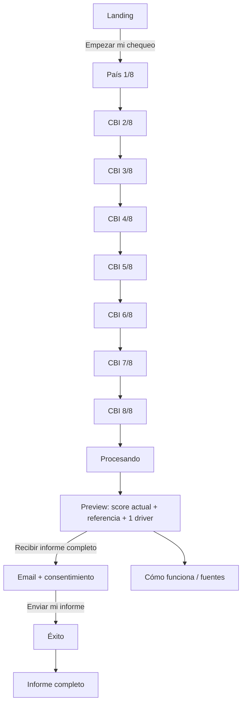
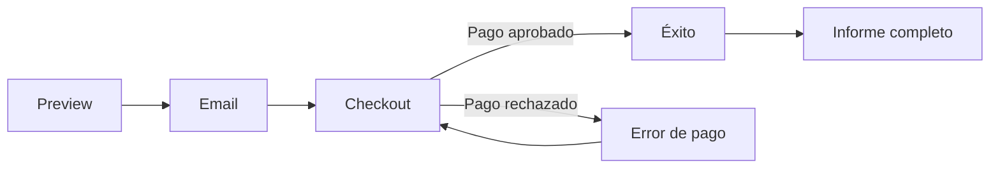
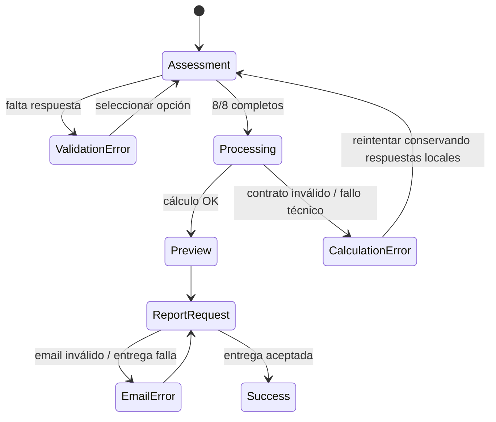

# Sitemap, rutas y flujos · StressCast

## Principio de arquitectura
Una ruta pública explica; una ruta de evaluación reduce fricción; una vista previa demuestra cálculo real; el informe profundiza. Ninguna ruta pública presenta el escenario de 30 días como pronóstico. El estado sensible de la evaluación no debe viajar en query strings ni URLs.

## Sitemap y rutas

| Área | Ruta | Objetivo |
|---|---|---|
| Landing | `/[lang]` | Promesa, confianza y CTA único a evaluación |
| Calculadora | `/[lang]/assessment` | País + 7 ítems, un input por pantalla en móvil |
| Procesando | `/[lang]/assessment/processing` | Confirmar cálculo determinista y preparar preview |
| Vista previa | `/[lang]/results/preview` | Score actual, referencia, 1 driver, teaser bloqueado |
| Solicitar informe | `/[lang]/report/request` | Email + consentimiento de entrega |
| Pago futuro | `/[lang]/checkout` | Solo fase 2, detrás de feature flag |
| Éxito | `/[lang]/report/success` | Confirmar entrega / abrir demo |
| Informe | `/[lang]/report/:verification_id` | Resultado completo; URL opaca/no enumerable |
| Cómo funciona | `/[lang]/how-it-works` | Método, CBI, escenarios y límites |
| FAQ | `/[lang]/faq` | Objeciones, evidencia, privacidad |
| Privacidad | `/[lang]/legal/privacy` | Datos, finalidades, retención, derechos |
| Términos | `/[lang]/legal/terms` | Condiciones de uso |
| Disclaimer | `/[lang]/legal/wellness-disclaimer` | No diagnóstico / no decisiones laborales |
| Fuentes | `/[lang]/sources` | Evidencia y licencias |
| Admin | `/admin` | Funnel agregado, QA/model version; sin respuestas individuales por defecto |

`lang`: `en`, `es`, `pt-br`.

## SEO programático
Las páginas SEO educan y llevan a una única acción: iniciar el check. No deben crear páginas doorway ni afirmar validación local que no exista.

- `/[lang]/work-burnout-check/[country]`
- `/[lang]/work-burnout/[use-case]`
- `/[lang]/cbi-work-burnout/[country]`
- `/[lang]/work-exhaustion/[use-case]/[country]`

Países iniciales: `united-states`, `united-kingdom`, `canada`, `australia`, `brazil`, `mexico`, `spain`.  
Casos de uso iniciales: `managers`, `consultants`, `founders`, `remote-workers`, `knowledge-workers`.

Reglas SEO:
1. Canonical por idioma/país y `hreflang` coherente.
2. La evidencia PUMA siempre se describe como danesa/contextual.
3. No usar “diagnose burnout”, “predict burnout” ni equivalentes como promesa.
4. ES/PT del cuestionario no se indexan como “validated wording” hasta cerrar el gate lingüístico.
5. Structured data permitido: `WebApplication`, `FAQPage` solo si el contenido visible coincide; nunca `MedicalWebPage` salvo revisión legal específica.

## Flujo principal · fase 1

## Flujo futuro · fase 2 de pago

La fase 2 permanece detrás de `payment_enabled=false` hasta cumplir los gates de `monetizacion.json`.

## Flujo de error y recuperación

## Navegación y estado
- El header durante assessment contiene logo, idioma y “Salir”; no agrega navegación secundaria.
- El progreso es persistente y textual (“Pregunta 5 de 8”), no solo visual.
- Atrás conserva la respuesta; adelante requiere una selección explícita.
- Refresh: conservar respuestas solo en `sessionStorage`/estado de sesión cuando sea viable; no persistir más allá de lo necesario.
- No incluir score, respuesta ni email en URL, logs de navegación o analytics de terceros.
- El informe usa un ID opaco de verificación, no email ni hash reversible de email.
